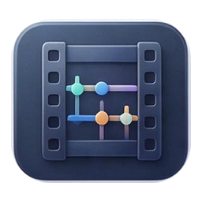
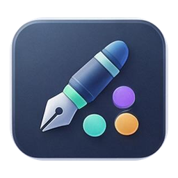
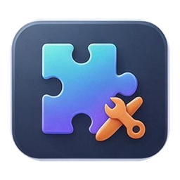
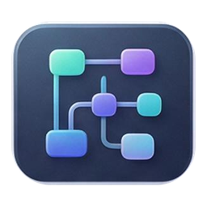
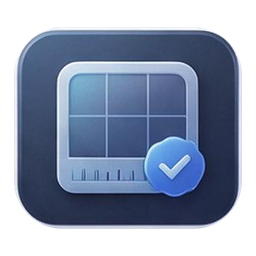
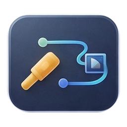
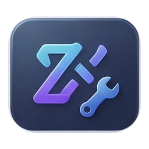
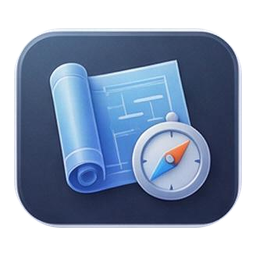
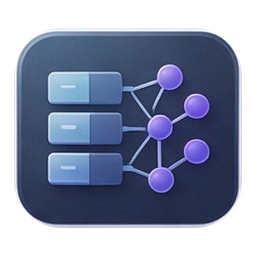

# HiMind Extensions 图标索引

母版：`himind-extension-icon-atlas-0-c6947eea.jpg`（2048×2048，5×7，共 35 个）

| # | 类型 | 扩展 | 图标 | 主题 |
|---:|---|---|---|---|
| 1 | plugin | 科技雷达 `com.himind.tech-radar` |  | radar scanning repository nodes |
| 2 | plugin | 微信小程序开发工具 `com.himind.wechat-miniprogram-tools` |  | speech bubbles plus code brackets |
| 3 | plugin | 媒体资源库 `com.himind.media-library` |  | stacked media cards with play |
| 4 | plugin | 媒体下载工具 `com.himind.media-downloader` |  | download arrow in play frame |
| 5 | plugin | 媒体处理工具 `com.himind.media-toolkit` |  | film strip with sliders |
| 6 | plugin | IOStudio 工具 `com.himind.iostudio` |  | hardware board ports waveform |
| 7 | plugin | 工作日志工具 `com.himind.work-log` |  | notebook calendar check |
| 8 | plugin | 工作日志采集器 `com.himind.work-log-collector` |  | chat bubbles into folder |
| 9 | plugin | 媒体 AI 工具 `com.himind.media-ai` |  | neural spark with film frame |
| 10 | plugin | 界面设计工具 `com.himind.ui-ux-design-tools` |  | pen tool and swatches |
| 11 | skill | 插件开发助手 `com.himind.skill.develop-himind-plugins` |  | puzzle piece and wrench |
| 12 | skill | 技能开发助手 `com.himind.skill.develop-himind-skills` |  | open manual with sparkle |
| 13 | skill | 工作流开发助手 `com.himind.skill.develop-himind-workflows` |  | branching flow diagram |
| 14 | skill | 扩展开发规范 `com.himind.skill.develop-himind-conventions` |  | ruler and checklist |
| 15 | skill | 工程工作流助手 `com.himind.skill.dev-workflow-orchestrator` |  | conductor baton and nodes |
| 16 | skill | Git/SVN 提交摘要 `com.himind.skill.git-svn-commit-summary` |  | branch merge into document |
| 17 | skill | MCP 体验反馈 `com.himind.skill.mcp-experience-feedback` |  | speech bubble with loop arrows |
| 18 | skill | 软件分发助手 `com.himind.skill.software-distribution` |  | package with release arrow |
| 19 | skill | 软件界面规范 `com.himind.skill.software-ui-spec` |  | grid ruler and check |
| 20 | skill | 媒体下载助手 `com.himind.media-downloader-assistant` |  | assistant spark and download |
| 21 | skill | 工作日志助手 `com.himind.skill.work-log` |  | clock over notebook |
| 22 | skill | UNIHper 开发助手 `com.mrbaoquan.skill.unihper-unity-development` |  | game cube controller and code |
| 23 | skill | 视频动作编排助手 `com.himind.skill.video-motion-authoring` |  | camera and motion path |
| 24 | skill | 长任务推进助手 `com.himind.skill.long-task-driver` |  | relay baton on track |
| 25 | skill | 微信小程序开发助手 `com.mrbaoquan.skill.wechat-miniprogram-assistant` |  | speech bubble and app window |
| 26 | skill | 界面设计助手 `com.himind.skill.ui-ux-design-assistant` |  | palette cursor and sparkle |
| 27 | workflow | 软件发布 `com.himind.workflow.software-release` |  | pipeline arrow and rocket |
| 28 | workflow | 科技雷达工作流 `com.himind.workflow.tech-radar` |  | radar and report page |
| 29 | workflow | 每日工作日志 `com.himind.workflow.daily-work-log` |  | sunrise over journal |
| 30 | workflow | 微信小程序 CI 交付 `com.himind.workflow.wechat-miniprogram-ci-delivery` |  | speech bubble gear upload |
| 31 | expert | 软件工程师 `com.himind.expert.software-engineer` |  | code brackets and wrench |
| 32 | expert | 项目架构师 `com.himind.expert.project-architect` |  | blueprint and compass |
| 33 | expert | 高级系统架构师 `com.himind.expert.senior-system-architect` |  | layered system blocks network |
| 34 | expert | 高级 UI 设计师 `com.himind.expert.senior-ui-designer` |  | design compass and screen |
| 35 | expert | 高级测试工程师 `com.himind.expert.senior-test-engineer` |  | shield magnifier and check |
