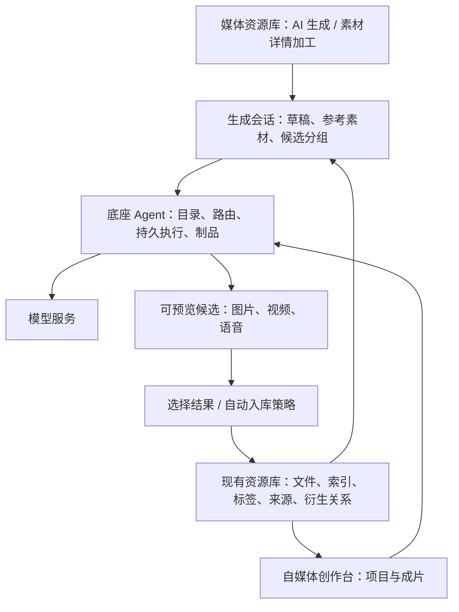

# 媒体资源库 AI 生成与加工功能架构

日期：2026-11-15。状态：设计方案，尚未实施。前提：底层 AI 能力由底座 Agent 统一提供。本轮只读检查现有接口与代码，没有调用付费生成、修改 AI 服务配置、构建或替换生产 Agent。

## 1. 产品定位与所有权

媒体资源库负责“获得素材 → 筛选 → 入库 → 整理 → 复用”。AI 生成是一类素材获取方式，基于现有素材生成是一类派生加工；正式资产继续使用现有资源库。

| 所有者 | 负责的内容 |
| --- | --- |
| 底座 Agent | 能力目录、服务/模型绑定、凭据、参数限制、调用、计费与预算、执行任务、取消、结果制品和保留策略 |
| 媒体资源库 | 生成表单、参考素材选择、生成草稿、结果分组与筛选、目标库、入库、来源及衍生关系、检索 |
| 自媒体创作台 | 项目、脚本、分镜、多镜头、角色连续性、时间线、成片制作；调用相同 Agent 能力并引用资源库素材 |
| 领域扩展 | 音频制作负责多段配音、混音；音频智能负责字幕对齐；视觉扩展负责参考包与视觉 QA；媒体处理工具负责确定性转码等 |

模型与服务遵守媒体库已有 2.9 约定：由 Agent 路由，插件不保存独立的服务默认值、密钥或降级顺序。界面展示 Agent 解析出的模型与可用性；用户修改全局路由时进入 Agent 的统一设置。声音、参考图和内容模板是用户的创作输入，可以在媒体库选择。



## 2. 可设计的功能

| 功能 | 用户输入与参数 | 输出与后续动作 | 阶段 |
| --- | --- | --- | --- |
| 生成图片 | 画面描述、比例/尺寸、数量、质量 | 候选图比较、选择入库、继续改图、作为视频参考 | 第一阶段 |
| 修改图片 | 从库中选择参考图、修改要求；支持时选择蒙版 | 新图片及参考关系，保留原图 | 第一阶段 |
| 合成语音 | 文本、音色、语速、格式；模型支持时提供情绪 | 试听、波形、文本关联、保存为语音素材 | 第二阶段 |
| 生成视频 | 视频描述、时长、比例、分辨率 | 播放、抽帧预览、入库 | 第二阶段 |
| 图片生成视频 | 参考图和运动描述；支持时选择首尾帧 | 视频与参考图的派生关系 | 第二阶段 |
| 批量生成与复用模板 | 多组描述、模板、输出策略 | 分组结果与逐项状态、批量入库 | 第三阶段 |
| 语音转文字 | 选择音视频、语言 | 文本/字幕附件；字幕对齐调用领域扩展 | 第三阶段 |

现有 AI 打标、描述、OCR 和自动整理继续留在整理流程，与生成结果共用正式资产。生成音乐、音效、声音克隆、视频延长和口型同步，待 Agent 提供并验证相应能力后再开放；不因有同名界面就宣称可用。

“生成封面”“商品图”“场景图”等适合做输入模板：填充描述和尺寸，不复制生成执行器。多镜头故事、角色一致性制作、字幕配音混合与完整成片进入自媒体创作台。

## 3. 桌面入口与操作路径

- 顶部增加“AI 生成”，打开同一插件窗口内的生成工作区，提供“图片 / 视频 / 语音”。保留现有导航和“后台任务”入口。
- 素材详情增加适用动作：图片“修改图片 / 生成视频”，音视频“转文字”；按素材类型、Agent 能力和模型限制显示。
- 生成工作区采用参数区与结果区：参数区包含输入、参考素材和目标库；结果区以一次生成为一组，展示候选和状态。默认窗口并排，最小桌面窗口可收起参数区，保留预览和主操作。
- 常用参数直接展示，其余进入“更多参数”。采用业务表单结合 Agent 元数据，用户不需要编辑 provider JSON。
- 主按钮按任务命名：“生成图片”“生成视频”“合成语音”。提交成功即可离开工作区；后台任务可返回对应结果组。
- 返回时恢复草稿、结果组及任务引用；切换结果沿用现有资源预览的图片缩放、视频播放和音频试听。
- Agent 尚未配置某种能力时，保留对应类型及明确的配置说明，并提供统一设置入口；用户仍能查看过去的生成结果。

默认“预览后入库”，生成前预选当前资源库作为目标，生成后可一次选择多个候选保存。提供“生成后自动入库”选项并按目标库记住选择，适合确定性较高的重复生产。预览模式的候选有明确保留期限和待处理入口；自动入库模式完成后直接定位正式素材。

“AI 生成”是素材来源属性，图片/视频/音频仍是素材类型。合成语音标记用途为“配音”，不会自动进入“我的 BGM”；音乐、环境声和音效分别保留用途字段。

本方案仅面向 Windows 桌面；真实默认/最小窗口、键盘、溢出与状态需实施后 e2e，不包含移动端、读屏或 200% 缩放。

## 4. 执行、恢复与入库

执行状态和入库状态分别记录：

```text
执行：草稿 → 已提交 → 排队/运行 → 成功 / 失败 / 已取消 / 待核对
结果：待筛选 → 入库中 → 已入库 / 入库失败 / 已丢弃 / 已过期
```

执行状态以 Agent 为准，媒体库只保存执行引用和界面投影；目标库、选择结果和入库状态由媒体库负责。用户看到的“正在生成 / 待入库 / 已入库”由这两类状态组合，不创建第二套模型执行队列。

1. 保存生成意图与参考素材版本，取得 Agent 能力元数据并预检。目标库不可写时，自动入库模式需先修改目标；预览模式可生成后再选择目标。
2. 使用唯一请求键提交。Agent 在调用服务前持久记录；重复点击或同一提交重试返回原执行。
3. Agent 按既有协议执行。同步 Provider 可由 Agent 的可选后台包装承接；异步 Provider 保留上游任务身份。原生同步能力仍可供其他调用者直接使用。
4. Agent 将结果落为受控本机制品，返回稳定引用、输出序号、哈希和实际执行元数据。媒体库恢复结果组并预览；同一组允许部分结果成功。
5. 保存时按“结果引用 + 目标库”幂等入库，复用文件校验、按库哈希去重、原子发布和目录事件机制；每个输出单独记录入库结果。
6. 入库成功后建立资产与生成记录、参考素材的关系，并确认正式文件已持久保存。临时制品的释放由 Agent 保留策略负责。

必须覆盖的恢复规则：

| 情况 | 处理 |
| --- | --- |
| 关闭或重开媒体库 | Agent 继续执行；媒体库根据会话与 job 引用恢复 |
| Agent 重启 | 对可查询的异步上游任务续查；同步请求若结果不确定则标记待核对，不能自动重复提交 |
| 请求超时、提交结果未知 | 使用请求键查询原执行；未核对前不自动再生成 |
| 生成成功但 SMB/目标目录不可写 | 保留结果，显示入库失败；允许重试入库或更换目标，不再次调用模型 |
| Provider 不支持取消 | 按实际能力显示停止等待/停止后续处理，保留上游状态，不声称已取消计费 |
| 某些输出失败 | 保留成功候选，明确失败输出；重新生成是新的执行，记录关联 |
| 暂时丢失参考文件 | 使用提交时保存的受控引用与哈希；未准备完成则阻止提交 |

执行进度优先消费 Agent 事件；暂时没有订阅时，对可见的活动任务集中查询并退避，后台静止页面停止高频查询。不能为了更新任务要求插件视图常开。

## 5. 数据结构与正式资产

| 数据对象 | 归属 | 关键内容 |
| --- | --- | --- |
| 生成草稿/会话 | 媒体库 | 类型、描述/文本、参考资产、参数、目标库、入库策略、结果组 |
| 执行记录 | Agent | job/request ID、幂等键、实际服务/模型、参数快照、尝试、用量、执行状态 |
| 结果制品 | Agent | media/artifact 引用、输出序号、哈希、格式、尺寸/时长、保留时间 |
| 会话与执行引用 | 媒体库 | session ID、Agent 实例身份、job/request ID、父执行、结果索引 |
| 正式素材 | 媒体库 | 沿用 library_items、文件索引、标签、预览和内容哈希 |
| 生成来源与衍生关系 | 媒体库 | asset ID、执行摘要、提示词、实际参数、参考哈希、父资产、模板版本 |

建议新增 `generation_sessions`、`generation_execution_refs`、`generation_outputs` 和通用 `asset_derivations`，并将生成来源附着到既有资产来源模型。已有 `ai_job_state` 是“精选集 → 打标作业”的单记录结构，不直接扩成所有生成历史。

Agent 的 media registry 当前仅保留最近 500 条，提示词摘要也有截断；正式入库时必须保存完整 Generation Manifest 和可用的原始参数。长期追溯不能只依赖 `media_id` 或 Provider 的临时 URL。

Generation Manifest 至少包含 schema 版本、能力、Agent 执行 ID、实际模型、用户输入、有效参数、参考资产 ID 与内容哈希、模板版本、生成时间、输出哈希和用量状态。未知 seed、费用或许可保持未知；“再次生成”代表复用参数，不承诺模型升级后逐像素复现。

修改图片产生新素材；不同结果可以属于同一版本组，原素材不覆盖。文件按内容去重，生成事件和参考关系仍分别保留。共享库通过现有目录事件/来源元数据扩展同步生成 Manifest，其他设备可看来源但不能假定能控制原机器的执行任务。

参考素材来自本机或 SMB 时，先由受控路径解析与暂存机制转为 Agent 可访问的稳定引用，并保存内容哈希；不要求用户手工复制路径。Agent 负责临时制品的保留/占用引用，避免用户正在筛选的结果被自动清理。

## 6. Capability 接入与待补接口

已存在的底座入口：

| 用途 | 现有 Capability |
| --- | --- |
| 能力与模型元数据 | `media.provider.catalog` |
| 生图 / 改图 | `media.image.generate` / `media.image.edit` |
| 文生 / 图生视频 | `media.video.generate` |
| 合成语音 / 转写 | `media.audio.speech` / `media.audio.transcribe` |
| 音色目录 | `media.audio.voice.list` |
| 异步媒体任务 | `media.job.get` / `media.job.wait` / `media.job.cancel` |

按现有接口和实际调用能力逐步接入，不重新注册这些公共 ID。媒体库视图需要补精确的 `external_capabilities` 白名单，沿用生产 Capability Gateway；不引入服务商 HTTP 或凭据通道。

底座需要先核实并补齐以下通用契约，以下为设计需求，不能当作现有支持：

- 可持久提交与列举的媒体执行包装，可考虑 `media.job.start` / `media.job.list`；扩展现有 get/cancel 语义以覆盖同步 Provider 的后台执行。允许提交的能力须为明确白名单。
- 提交前预检、请求键去重、上游提交未知状态、用户来源标签、每个输出的稳定序号，以及同步/异步一致的结果引用。
- 可持久读取的制品引用、外部参考素材受控导入、候选占用/释放与保留策略；保留时间由 Agent 返回，不在插件内猜测。
- 与实际模型绑定的参数选项，包括比例、尺寸、质量、音色、时长、数量、格式；静态适配器上限不能直接当作所有模型的承诺。

媒体库新增接口只表达应用业务，可采用 `media-library.generation.prepare`、`.list`、`.get`、`.adopt` 以及 `media-library.asset.lineage`。最终 ID、Schema 与实现期的底座契约一起确认；prepare 保存业务会话和参考信息，adopt 仅接收可信结果引用及目标，不接受前端任意文件路径作为生成结果。

复用现有入库算法，但需把平台下载 URL 专属校验与通用文件入库规则拆开。AI 来源采用明确的生成来源类型，避免伪造抖音/下载来源。既有下载流程保持兼容。用量、价格、限额和降级信息以 Agent 返回为准，生成任务不套用媒体库旧打标预算里的 token 粗略估价。

## 7. 现状核对与实施顺序

2026-11-15 生产 Agent 只读目录核对：生图/改图已有配置；视频、语音合成、转写未配置。目录声明的适配器能力不等于模型已配置，也不等于联网调用健康。本轮没有进行生成测试。

| 阶段 | 交付 | 验收核心 |
| --- | --- | --- |
| M0 契约 | Agent 持久执行、结果、参数和参考引用接口；媒体库会话/入库 Schema | 同步与异步都可恢复；超时核对、重复提交和结果保留可验证 |
| M1 图片闭环 | 生图、改图、候选比较、入库、生成来源与再生成 | 一次真实生成，关窗重开，选多张入库，重复保存去重；改图不覆盖原图 |
| M2 视频与语音 | 文生/图生视频、音色选择、合成、播放试听，后台任务统一展示 | 使用已配置的真实服务分别完成链路；未配置态、失败与取消准确 |
| M3 复用与创作台联动 | 模板、批量、版本比较、来源筛选、转写附件、项目引用 | 模板与批量复用同一执行契约；创作台引用同一正式资产 |

每阶段覆盖：主入口、成功、空态/未配置、错误、取消/切换、重复操作、关窗恢复、入库失败只重试入库；默认与最小桌面窗口做真实 DOM 几何审计。扩展按生产 Agent 的 MCP/Gateway 或 e2e 构建、候选测试和激活。若 M0 需要改宿主，单独说明宿主更新范围；不为扩展自动替换正在运行的 Agent。

实施首选 M0 → M1，验证一条完整图片链路后再拓展类型。媒体库 UI 和业务入库可独立发版，底座作为通用执行与制品基础设施演进。

## 8. 方案依据

- [Agent 媒体提供方平面](../../HiMind-Agent/docs/adr/0012-media-provider-plane.md)
- [AI 能力归属](../../HiMind-Agent/docs/adr/0014-ai-capability-provider-landing.md)
- [AI 执行契约](../../HiMind-Agent/docs/adr/0016-ai-capability-execution-contract.md)
- [现有媒体库统一架构](media-library-unification-architecture-2026-11-14.md)
- [媒体库现有 AI 服务归属](../plugins/media-library/README.md)

底座相关依据路径相对于本工作区的并列仓库，文档分发到独立仓库后需改为相应 ADR 的仓库地址。

## 9. 实施状态（2026-11-15）

媒体库 2.16.4 已完成分类型草稿、只读记录与显式复用、原任务核对、按目标入库、统一候选预览与可信结果继续加工、视觉参考图、音色目录接入和来源动作。生产 Gateway 构建、候选门禁及桌面默认/最小真实 e2e 已完成；具体已验证和未验证分支见 [体验优化交付](media-library-ai-generation-ux-implementation-2026-11-15.md)。

本版收起自动入库，统一选择结果后手动入库；不能把临时 Capability Broker 通道作为可靠后台协调器。本文第 4 节的持久自动入库仍为后续设计，不能视为本版支持。

生产宿主仍为 0.3.93，缺少 media.job.start/list；未部署原宿主候选，未付费生成。因此 M1 的真实成功、运行恢复和成功入库未验收，M2 的真实视频、语音与音色试听未验收；不把插件 UI 完成当成全部生成能力已可用。

完整证据、候选哈希和验收报告位于聚合工作区 `.himind/long-tasks/20261115-media-ai-ux/`。原底座候选与架构实施记录保留在 `.himind/long-tasks/20261115-media-library-ai-generation/`。
