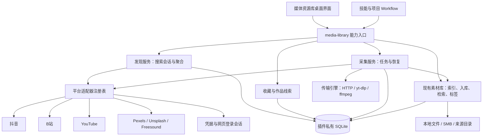

# 媒体资源库统一架构方案

日期：2026-11-14。状态：统一采集、三平台官网搜索与兼容迁移已实施并在生产Agent验收；旧下载工具保留兼容路径。实际支持边界、门禁与证据见[交付验收记录](audits/media-library-unification-2026-11-14.md)。后文设计目标中尚未开放的能力不能视为支持承诺。

## 1. 架构决策

将媒体下载工具合并进媒体资源库，保留产品名「媒体资源库」、插件 ID `com.himind.media-library` 和能力命名空间 `media-library`。下载成为内部的「采集任务」，平台搜索成为「在线发现」。

采用一个插件、清晰的内部模块、可独立替换的平台适配器。当前不增加常驻服务、独立账号中心或第二套素材数据库，也不因每增加一个平台而增加一个插件。

产品负责「发现 → 收藏线索 → 采集 → 正式入库 → 检索和使用」。本机索引、已有素材库、标签、精选、AI 打标、SMB 与许可记录继续保留。短视频项目插件负责项目内的来源台账和素材引用，通过能力接口使用统一媒体库，避免再实现平台登录、搜索和下载协议。

平台扩展是能力的增加，不是复制应用。抖音、B站、YouTube 可以有各自的搜索条件、登录要求和错误提示，共享收藏、任务、文件管理与入库机制。

## 2. 产品入口与桌面信息架构

| 一级入口 | 职责 | 主要动作 |
| --- | --- | --- |
| 素材 | 已入库素材和已索引本机文件，保留现有范围筛选 | 检索、预览、标签、分类、精选、项目引用 |
| 在线发现 | 按平台检索在线作品及开放素材 | 选平台、搜关键词、查看详情、收藏、下载并入库 |
| 收藏 | 用户主动保存的在线线索，文件可能尚未下载 | 分类、备注、补采集、定位已入库素材 |
| 精选 | 原有精选集与筛选决策 | 预选、人工决策、加入精选库 |
| 库 | 素材库与精选库浏览 | 浏览、同步与管理 |

采集任务采用右上角常驻按钮与任务面板，不占一级导航。账号、平台可用性和下载组件放在设置中，平台页面只提供与当前操作有关的登录提示。保留全局「添加链接」入口，支持直接下载，不要求先搜索。

「在线发现」默认一次选择一个平台，提供「全部平台」作为聚合选项。平台选择与平台特有筛选放在同一处；切换平台保留关键词，重置不兼容筛选。只有实际支持的筛选才显示，接口调用传入不支持的筛选时返回明确错误，不能悄悄忽略。

在线卡片统一展示封面、标题、作者、时长、来源及「已收藏／已入库」状态；播放量等平台指标作为附加信息。首期在线预览以封面、详情和打开原网页为基础，只有平台明确提供可用播放能力时才显示站内播放。已入库文件沿用现有本地 Range 预览端点。

采集动作明确提供「下载并入库」和「仅保存文件」，记住用户上次选择；从素材库发起时预选当前目标库，从原下载入口迁入时保留原保存目录和仅保存文件的习惯。未确认目标、格式和保存模式时，不因搜索或收藏自动下载。

本方案只覆盖 Windows 桌面，不新增移动适配、读屏或 200% 缩放验收范围。

## 3. 模块边界与依赖



依赖方向为能力入口调用业务服务，业务服务调用平台协议和基础设施。UI 不负责生成平台签名、拼下载命令、保管 Cookie 或决定任务恢复；平台适配器不写素材库和标签；传输引擎不决定素材归属。

逻辑模块建议为 `discovery`、`providers`、`sessions`、`acquisition`、`transfer`、`library`。先通过明确接口和文件边界抽离公共实现，再按需要移到 Go 内部包，避免合并时同时大规模重写现有媒体库。

主程序仍使用 process-jsonrpc-stdio；耗时任务复用现有后台子进程模式，统一由 `media-library.exe --worker ...` 执行。父进程和 worker 显式使用同一已解析数据根与数据库，根不可写时明确失败，不能分别回退到不同目录。打开界面不是任务存活的前提。

## 4. 平台适配契约

### 4.1 静态支持与运行状态分开声明

平台描述包含 `id`、名称、媒体类型、认证方式、每项操作的支持情况、可用筛选和适配器版本。操作至少区分关键词搜索、详情解析、在线预览、视频下载、音频提取、字幕、合集／播放列表。后续作者搜索、作者作品和直播另行声明，不能由「支持下载」推导。

认证方式显式区分 `anonymous`、`api_key`、`web_session`，需要组合认证的平台可声明多种要求。测试来源另设 `is_test_provider`，不再以空 `CredentialID()` 判断 Fake 来源；否则真实免密或网页登录平台会被现有媒体库逻辑过滤。

每项能力同时有支持状态（`supported`、`experimental`、`unsupported`）和运行状态（例如就绪、待登录、待配置、限流、运行时缺失、平台暂不可用）。状态可按操作分别变化；登录成功不能直接代表关键词搜索通过。

建议内部契约：

```text
Describe() -> ProviderDescriptor
Search(query, filters, cursor, authContext) -> SearchPage
Resolve(resourceRef, authContext) -> ResourceDetail + FormatOptions
PrepareTransfer(resourceRef, selectedVariant, authContext) -> TransferPlan
```

不支持的操作允许不实现。`authContext` 由受控会话层提供，仅在进程内使用；`TransferPlan` 为内部临时对象，不把 Cookie、签名直链或平台响应暴露给模型和日志。直链临近使用时重新解析，入库记录保存稳定来源页。

来源提供语义化结果，采集服务选择和执行传输。HTTP、yt-dlp、ffmpeg 是可复用的执行工具；抖音官网详情网关、签名和登录判断仍属于抖音适配器。通用 yt-dlp 链接解析作为兜底来源，不据此宣称所有站点都支持搜索。

### 4.2 接入优先级与真实能力基线

| 来源 | 已核对的当前基础 | 搜索接入方案 | 交付边界 |
| --- | --- | --- | --- |
| Pexels / Unsplash / Freesound | 媒体库已有检索适配代码和 Broker 凭据接口 | 包装现有实现，保留原过滤与许可 | 不因新增视频平台破坏现有来源；本轮未重新联机验收 |
| 抖音 | 下载工具 0.2.8 已完成真实链接解析、格式选择和下载 | 原生适配器，独立验证关键词搜索、会话、游标与限流 | 详情下载已验证；关键词搜索尚未验证 |
| B站 | 本轮未接入和验收 | 独立搜索／详情适配器，按需要复用下载引擎 | 逐项通过后开放，不预先标记可用 |
| YouTube | 本轮未接入和验收 | 优先评估官方搜索 API；另评估 yt-dlp 搜索适配的稳定性 | API 配额、网络与登录要求明确显示 |
| 其他 yt-dlp 站点 | 现有工具具备通用链接解析入口 | 暂保留粘贴链接采集 | 站点和单条链接是否可用，以解析结果为准 |

抖音候选开源参考为 Apache-2.0 的 [F2](https://github.com/Johnserf-Seed/f2)，本轮调研基线 commit 为 `f6be8c0ffba9a127075bbeafe4838716650b6325`。其存在通用搜索端点和模型定义，也有主页作品搜索实现；这不足以证明通用关键词搜索已完整可用。先做真实接口验证，再选择少量协议实现移植或固定版本侧车；默认不为了接库给用户增加系统 Python 依赖。引入代码时核对许可证及通知文件。

## 5. 搜索会话、分页与聚合

新搜索使用短时异步会话：创建后立即返回 `search_id`，各平台独立完成并增量可见。现有同步 `media-library.search` 保留原返回结构，继续服务原调用方；新 UI 使用独立的新接口。

每个平台分别保存状态、结果批次、错误、`next_cursor`、`has_more` 和 `retry_after`。游标是不透明的服务端引用，包含平台会话所需上下文但不返回凭据；不能用一个全局 page 模拟所有平台。逐平台重试不清空其他已完成结果。

切换关键词、平台、账号或筛选条件时增加查询 generation；迟到结果只能写回所属会话，不能覆盖当前列表。缓存键包含查询条件、适配器版本与非敏感账号代际，账号退出后失效。短时缓存与搜索结果设 TTL，不把每次浏览都变成永久素材记录。

跨平台聚合初期按平台分组并保留各自相关性顺序；后续可做明确的交错展示。不同平台的播放量、点赞量和搜索分值不可直接混成「全网热度」。关键词翻译和 AI 改写为后续可选功能，保留原查询并显示实际执行的条件。

平台限流、验证码、登录失效、网络失败和无结果是不同状态；验证码交回平台网页完成，禁止在后台无限重试。全失败显示失败，部分失败保留成功结果，无结果不伪装成网络故障。

## 6. 数据所有权与模型

### 6.1 区分作品、线索、文件和入库条目

| 对象 | 身份与所有者 | 生命周期 |
| --- | --- | --- |
| 在线作品 `RemoteResource` | 平台 + 原生作品 ID；发现服务维护规范来源引用 | 被收藏或采集时持久化，包含元数据快照和更新时间 |
| 搜索结果 `SearchHit` | 搜索会话 + 平台 + 结果引用 | 短期缓存；单次结果可只有封面、来源页，无下载直链 |
| 收藏 `Bookmark` | 本机用户 + 在线作品引用 | 用户主动保存，可加标签、分组、备注；不等于文件已存在 |
| 采集任务 `Acquisition` | task_id + 幂等请求键 | 保存意图、目标、格式、阶段、输出及错误 |
| 采集文件 `AcquisitionFile` | 文件清单 + SHA256 + 变体描述 | 记录视频、音频、字幕等实际输出及所在位置 |
| 现有候选 `Candidate` | 本机路径与来源目录 | 继续由扫描管理，不接收没有本地路径的在线结果 |
| 现有入库条目 `LibraryItem` | 目标库 + SHA256 | 文件正式入库后成立，保留来源、许可和任务关联 |

一个作品可有多种分辨率、音频和字幕文件，也可采集到多个目标库；不能把「作品 ID」「本地文件」「库条目」强行合成一个 ID。平台 ID 用于作品去重，SHA256 用于文件内容去重；相同字节但不同来源仍应保留全部来源关系。

已知作品优先使用平台原生 ID，短链接先规范化。暂时无法取得稳定 ID 的记录标记为临时引用，解析后合并，不能永久使用带跟踪或签名参数的 URL 作为身份。搜索卡片的「已入库」通过来源关联查询；多个格式只显示关联状态，不凭作品 ID 判定所有变体均已下载。

### 6.2 存储策略

沿用媒体库私有 `library.db`，新增增量迁移，不重建现有 `libraries`、`source_roots`、`candidates`、`library_items`、FTS 和用户状态。产品版本号与现有 `schema_v3.go` 的迁移名称独立。

建议新增 `remote_resources`、`bookmarks`、`search_sessions`／`search_results`（TTL）、`acquisition_jobs`、`acquisition_files`、`asset_origins` 和 `outbox_events`。这些是逻辑表建议，实施时先核对现有收藏和精选能力，复用公共标签及备注服务，不把本机候选 ID 对应的状态直接改写为在线作品。

`asset_origins` 保留文件内容与多个来源的关系；入库去重时补充来源，保留已有用户标签和许可快照，不用新的抓取字段覆盖用户整理结果。收藏和来源记录至少包含作者、来源页、发现时间、许可及使用范围；未知许可按未知处理，个人可下载不自动等于可放进共享 SMB 素材库。

SMB 继续作为文件和共享目录后端，私有任务数据库留在本机。多台机器分别维护任务，不能把 SQLite WAL 直接放在 SMB 上充当跨机队列。共享 catalog 写入保留现有用户分区并做短时串行化；事件具备唯一 ID，读取和对账忽略重复事件，不能假定跨机器追加天然原子。

## 7. 采集与入库的一致性

### 7.1 一个后台任务状态机

正常流程：`queued → resolving → downloading → verifying → importing → completed`。仅保存文件在校验及最终文件提交完成后结束，不进入 importing。

| 分支 | 行为 |
| --- | --- |
| `waiting_for_login` | 保留任务意图，完成登录后重新解析临时下载信息 |
| `waiting_for_target` | 目标盘或 SMB 不可用，等待用户恢复或明确改目标 |
| `pending_import` | 文件已下载并校验，入库失败；默认只重试入库 |
| `interrupted` | worker 意外退出或租约过期；核对输出后恢复安全阶段 |
| `failed` / `cancelled` | 保存失败阶段和可执行动作；取消只清理本任务拥有的临时文件 |

记录结构化错误码，例如 `AUTH_REQUIRED`、`AUTH_EXPIRED`、`RATE_LIMITED`、`RUNTIME_MISSING`、`TARGET_UNAVAILABLE`、`IMPORT_FAILED`，附可恢复动作与脱敏诊断 ID。界面不直接展示命令行、Cookie、完整平台响应或含签名参数的媒体地址。

任务先持久化再启动 worker，携带幂等请求键避免重复点击重复采集。worker 通过 SQLite 原子条件更新领取任务，记录 lease、heartbeat 和 attempt；跨进程不能仅靠 Go 内存锁限制并发。每平台并发和退避独立，本地探测另设额度。网络、下载和复制时不持数据库长事务。

任务记录执行器和运行时版本，升级保留在途 worker 所需的版本文件。候选激活不能覆盖正在运行的二进制；版本清理在任务完成后执行，避免合并或升级造成一半任务按旧协议、一半按新协议恢复。

关闭扩展窗口后继续采集。下一次能力调用或打开扩展时检查过期租约、PID 身份和输出，给出恢复状态，不能因 PID 仍存在就判定任务仍活跃。系统重启后的自动常驻恢复不在首期承诺内。原 `ai_job_state.go` 记录的是 Agent AI job 引用，不能直接用作下载队列。

视频、音频、字幕按文件清单记录，失败重试只处理缺失阶段。播放列表保留父任务与子条目的关系及逐条完成状态；映射未完成前继续由旧下载入口处理已有播放列表能力，不以合并为由静默删减现有功能。

### 7.2 文件、数据库和 catalog 分步提交

1. 在任务私有 staging 目录下载到临时文件，校验实际输出、大小与格式，计算 SHA256；需要转封装或音频提取时，由受控工具执行。
2. 根据目标库和哈希查询去重记录。已有文件要核对可用性，再复用库条目并追加来源；缺失时恢复文件，不能只看数据库记录就宣称成功。
3. 跨盘或 SMB 复制到目标目录内的临时文件，再在该目录原子改名；不能跨卷直接 rename。记录提交意图和清单，失败时保留可恢复的 staging。最终文件名不取信任平台返回的路径片段，冲突不覆盖用户文件。
4. 在短事务中写库条目、来源关联、任务阶段和 outbox 事件。数据库与文件系统无法构成一个原子事务，用任务清单对账「已提交文件但未写 DB」的间隙。
5. outbox 按 `event_id` 幂等写 catalog，成功后确认。重放和扫描可修复 DB／catalog 间的间隙；SMB catalog 未同步时明确显示待同步，不能把跨介质写入当作已全部完成。

取消请求与提交阶段按任务版本串行判定；已完成提交的资产不会因迟到取消而删除。清理任务记录与删除素材分成两个动作；清理只删除可证明属于该任务且未被其他条目引用的临时文件，保留原有用户下载文件。

单插件内部「解析 → 下载 → 校验 → 入库」是确定性业务流程，由这一状态机执行即可。Workflow 用于跨插件的搜索策划、AI 处理、项目生成和用户编排，不要求每次入库另建 Workflow。这修正了先前将下载入库一律交给 Workflow 的建议。

## 8. 登录、凭据与运行时

网页登录继续使用独立受控窗口和加密会话，尽量一次登录后复用，到期或平台拒绝时再登录；不要求用户每次手工导出 Cookie。账号状态属于平台会话层，可同时供搜索、详情和下载使用，但按各操作分别探测可用性。

Windows 会话继续使用 DPAPI CurrentUser 和私有目录 ACL，账户引用与密文版本化。后台 worker 在当前授权和有效代际下临时解封装，调用后删除私有临时 Cookie 文件；退出账号使在途租约失效、取消后续认证请求，并清除该账号私有缓存，不删除已下载素材。任务绑定所选账号，切换账号后不静默换身份续跑。

Pexels 等现有 API Key 仍由 Agent Broker 按次提供，不能为了后台恢复把 Broker token 长期写盘或继承给脱离调用的 worker。首期对这类来源保留现有受控调用路径：在有效调用内解析并取得可用传输计划；若后续下载必须重新带密钥或调用已过期，则进入待授权恢复，在新的前台受控调用内续做。持久后台授权需另有 Broker grant 协议，当前不假设已经存在，也不能借旧插件身份读取新插件凭据。

下载运行时迁移现有固定版本、哈希校验、系统代理和重试实现，优先保留独立 yt-dlp 包无需系统 Python 的路径。ffmpeg／ffprobe 统一发现，但组件状态按功能拆开：没有 yt-dlp 仍可管理本地素材，没有搜索登录仍可检索本地，不能用一个总故障遮住全部功能。

现有 `media-library.runtime.status` 已返回 ffmpeg／ffprobe／exiftool 状态，保持原语义和字段；下载组件使用新增能力报告和安装，避免把旧调用方的 `available` 解释突然改为「下载是否就绪」。

## 9. 能力 API 与调用方兼容

下面列的是拟新增接口，不是当前已注册能力。使用现有 `media-library` 命名空间，ID 为 ASCII、2–5 段且不超过 40 字符。

| 拟新增能力 | 职责 |
| --- | --- |
| `media-library.provider.status` | 按平台和操作查询支持情况、登录及可用状态 |
| `media-library.provider.connect` | 启动受控登录，返回状态引用 |
| `media-library.provider.disconnect` | 撤销平台会话和账号缓存 |
| `media-library.search.start` | 创建平台搜索会话，返回 search_id |
| `media-library.search.status` | 按结果 revision 取增量、平台状态和游标 |
| `media-library.search.more` | 使用平台游标加载下一批 |
| `media-library.search.cancel` | 终止搜索会话，迟到结果不污染当前列表 |
| `media-library.remote.resolve` | 从作品引用或网页链接解析详情和格式选项 |
| `media-library.bookmark.save` | 幂等保存线上线索及用户备注 |
| `media-library.bookmark.list` | 查询收藏，关联采集和入库状态 |
| `media-library.bookmark.remove` | 移除收藏，不删除素材和任务 |
| `media-library.acquisition.start` | 以资源引用、格式、目标与幂等键创建采集 |
| `media-library.acquisition.status` | 返回阶段、逐文件结果与素材引用 |
| `media-library.acquisition.list` | 分页查询任务和历史 |
| `media-library.acquisition.cancel` | 按阶段取消任务 |
| `media-library.acquisition.retry` | 从失败阶段恢复，支持仅重试入库 |
| `media-library.acquisition.remove` | 移除历史记录，独立控制临时文件清理 |
| `media-library.acquisition.log` | 查询经过脱敏的诊断摘要 |
| `media-library.download.status` | 查询下载专用运行时 |
| `media-library.download.install` | 受控安装固定版本下载组件 |

已有 `media-library.provider.list`、`media-library.search`、`asset.*`、`source.*`、`repository.*`、`holdings.*`、`selection.*`、`organize.*` 和 `runtime.status` 保留。新增描述可加法扩展，但原字段和默认行为不变。新结果模型明确区分 `remote_id`、`candidate_id` 和 `library_item_id`，不通过填空的 `download_url` 伪装成旧格式。

查询接口只返回脱敏描述和引用；搜索会话写入短时缓存的本机副作用按实际规则声明。登录、安装、收藏、采集和删除等接口分别声明凭据与写入风险，不能为了调用便利统一标为只读。模型和 UI 共用同一能力业务入口，界面不绕过目标与权限校验。

旧能力 `media.downloader.*` 归旧插件所有。宿主要求能力符合清单 namespace，新媒体库不能直接注册这一组旧 ID；媒体库进程内的 legacy map 也不能让宿主自动发现未注册能力。

过渡期保留旧插件与注册项，旧调用方继续调用旧 owner，新入口调用新能力；同一任务只有一个 owner。现有 `media-downloader-assistant` 的技能内容和依赖声明必须同步迁移。在确认调用方切换前，不删除旧插件目录和 `extensions.json` 项，不承诺旧 ID 已透明转发。

如必须长期完全兼容旧 ID，需要单独评审宿主级 alias／授权委托或有明确路由支持的兼容插件。这属于额外协议工作，不作为本方案已具备的前提；优先通过受控迁移调用方完成退役。

## 10. 数据迁移、切换与回退

当前媒体库和下载工具使用不同插件数据根；下载工具还可能使用缓存目录回退。下载历史在 `jobs/<id>` 下，登录在 `site-sessions`，DPAPI entropy 为 `com.himind.media-downloader/douyin/v1`。直接复制目录到新插件身份不能完成会话迁移。

建议按以下次序实施：

1. **只读盘点**：由生产 Agent 解析实际插件数据根，统计历史、有效任务、运行时和会话版本，只返回数量、状态和不透明迁移引用。为数据库和迁移清单做私有备份，记录来源版本及校验信息，不触碰用户下载目录。
2. **建立迁移桥**：新增受控的旧插件导出／新插件接收实现。生产 Agent 授权一次性交接；Cookie 不经过能力参数、模型上下文和日志，不能通过硬编码兄弟插件目录绕过身份边界。当前尚无这一迁移能力，需作为正式实施项；桥无法安全交接时采用一次重新登录，保留旧会话可回退。
3. **完成在途任务**：等待旧 worker 完成，或由用户明确取消；不搬运行中进程。旧入口在切换窗口停止新增，读历史仍可用。未完任务继续由原版本处理，不能让两套 worker 接管同一任务。
4. **幂等导入**：历史带上 `legacy_owner`、`legacy_job_id`，重复迁移不重复建记录；原文件保持原位置，不自动全部入库。运行时只复用版本和哈希验证通过的组件，避免复制未知可执行文件。
5. **重新封装会话**：在当前 Windows 用户、旧授权和旧 entropy 下解密，由受控程序按新身份重新加密写入新会话目录。新 entropy、schema 和账号 generation 独立版本化，保留迁移映射；未通过平台操作校验的会话不标为可用。
6. **切换入口与调用方**：媒体库提供新任务入口，迁移技能依赖、导航与能力调用。旧入口展示迁移落点；不依赖未实现的任意跨插件后端调用。新增任务只写新库，旧历史保持只读。
7. **观察后退役**：迁移统计、来源映射和真实界面验收通过后，再明确退役旧写入口，最后移除旧插件分发项。原数据不随升级自动删除。

回退保留旧插件版本和旧数据、新库使用增量 schema 与迁移账本。切回前停止新任务写入，记录新任务已产生的文件和素材引用；它们不能被回滚脚本删除。旧版本不读取新格式历史，必要时使用独立的只读迁移报告核对。回退是切换 owner，不是让两边同时写同一批任务，也不是覆盖整个媒体库数据库丢弃其他新数据。

## 11. 分阶段实施与验收

| 阶段 | 范围 | 必须通过的退出条件 |
| --- | --- | --- |
| A：合并可靠采集链 | 抽离下载／会话／运行时，接入媒体库任务、仅保存文件及下载入库；暂不扩大平台搜索 | 原链接解析、格式选择、登录、后台下载不退化；入库去重；下载成功但入库失败可单独恢复；媒体库原功能回归 |
| B：抖音搜索闭环 | 在线发现、收藏、抖音关键词搜索和分页 | 真实账号搜索、详情、下载、入库全链通过；无结果、登录失效、限流、取消和分页去重通过 |
| C：逐平台扩展 | B站、YouTube，适配既有开放素材源 | 每个平台独立声明并验收搜索／详情／下载支持矩阵；一个平台失败不阻塞其他来源 |
| D：迁移与退役 | 数据迁移桥、技能调用切换、旧入口退役 | 运行中任务不丢、历史可追溯、会话安全迁移或明确重登、回退演练通过，再退役旧插件 |

阶段 A 可以引入新对象表和能力，不要求先完成所有平台。阶段 B 以关键词搜索技术验证为前置门槛；接口不稳定时只开放已验证的链接采集，不能以 UI 已完成替代平台能力通过。

实施验证包括：

- 有意义的契约测试：Provider 支持声明、游标归属、账号切换隔离、幂等请求、作品／文件去重差异。
- 任务恢复测试：租约冲突、worker 崩溃、目标盘不可达、DB 提交前后中断、catalog 重放、取消与提交竞态；使用隔离测试文件，不删除用户真实数据。
- 迁移测试：旧目录回退定位、旧 entropy、新密文版本、重复导入、未完任务原 owner 保留、回退后新文件保留；不输出凭据。
- 真实生产界面 e2e：从真实扩展入口刷新刚构建资源，覆盖平台选择与搜索、结果收藏、链接采集、任务恢复、入库后本地检索及预览，同时验证入口、空态和错误态。
- 扩展构建／打包／候选测试／激活使用生产 Agent MCP Capability 或相同 Gateway，e2e 操作也可；不另启 development Agent，不重启生产实例获取调试端口。验收记录实例身份和证据，不能用模拟桥接代替。

首期不承诺全平台搜索、所有合集／直播／图文支持、跨平台统一热度、多账号自动轮换、系统常驻服务或自动整理所有历史下载。已有功能缺乏新模型映射时保留旧路径并明确状态。

## 12. 实施交付与代码依据

媒体资源库2.10.0已完成共享下载内核、可靠采集入库、平台官网搜索、收藏与旧终态历史导入。媒体采集助手0.2.0已切换默认调用方。媒体下载工具0.2.8保留播放列表和旧owner，不在本次交付自动删除或退役。受控一次重登替代跨插件复制会话，运行时独立安装；未承诺旧ID透明转发。

主要本地依据：

- [媒体库清单](../plugins/media-library/plugin.json)、[Provider 实现](../plugins/media-library/providers.go)、[能力入口及凭据判断](../plugins/media-library/main.go)。
- [数据库与已有对象](../plugins/media-library/library_store.go)、[入库与 catalog](../plugins/media-library/adoption.go)、[运行时状态](../plugins/media-library/enrich.go)、[用户状态](../plugins/media-library/user_state.go)。
- [下载工具兼容入口](../plugins/media-downloader/main.go)、[共享后台任务](../internal/mediadownload/jobs.go)、[共享数据目录](../internal/mediadownload/paths.go)、[会话管理](../internal/mediadownload/session.go)、[Windows 加密会话](../internal/mediadownload/session_windows.go)。
- [抖音详情适配](../internal/mediadownload/douyin_adapter.go)、[0.2.8 实施与下载验证记录](audits/media-downloader-adapter-2026-11-14/implementation.md)、[媒体采集助手](../skills/media-downloader-assistant/SKILL.md)。
- 同工作区其他仓库参照：宿主 `HiMind-Agent/src/capability/plugin.rs` 的 namespace 校验；短视频插件 `himind-short-video/plugins/com.himind.media-source/media-source` 的项目来源台账边界。

仓库存在其他任务的未提交修改，尤其媒体库、下载工具和宿主均非干净工作副本。回滚依据本任务当前文件备份与增量before目录，不用Git HEAD覆盖其他修改，不替其他任务验收。

检查与交付记录：

- 新能力命名、依赖、Manifest、包、runtime与生命周期通过生产候选测试；最终包、开发激活资源及工作副本关键文件SHA256一致。
- 共享内核与媒体库137项Go测试、Go vet、JavaScript语法和.NET连接组件构建通过；平台搜索/采集/入库/播放与桌面真实DOM验收见交付记录。
- `HiMind-Agent/frontend` 的 `npm run check:ui` 通过；有既有 Node 模块类型及重复文案提示，未修改无关文件。
- `cargo fmt --check` 通过。
- `cargo check --locked` 未通过：在 `libsqlite3-sys 0.30.1` 编译 SQLite C 源时遇到现有 MSVC D8050，`c1.dll` 未能将命令行放入调试记录。未修改宿主或工具链来绕过，本轮没有 Rust 改动。
- 三平台各两组关键词分页、文件哈希/来源和真实素材播放通过；旧历史幂等导入、仅保存MP3、关闭视图后台完成、默认/最小桌面与键盘路径通过。真实字幕、生产破坏性换号、外部客户端逐一对话及真实密钥素材站下载未验，边界在交付记录中保留。
